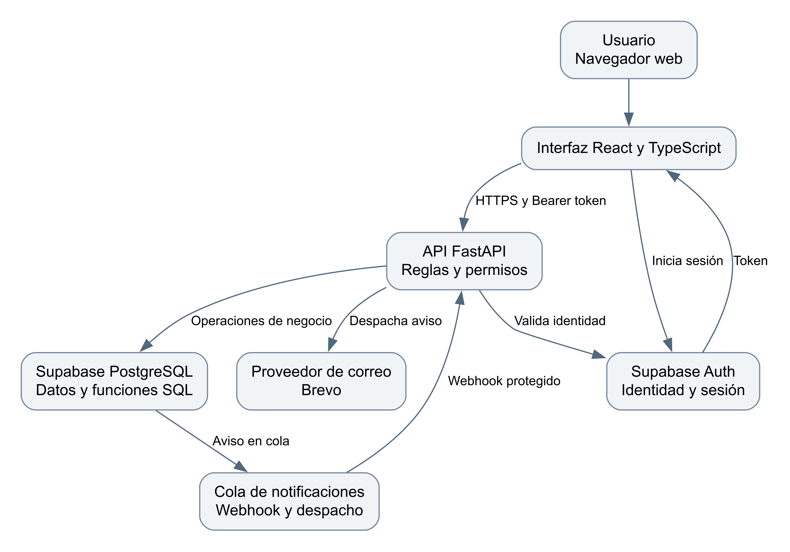

# Arquitectura de la solución HuellApp

HuellApp · Pudú Tech · Borrador 0.1 · 27 de octubre de 2026

La solución inspeccionada utiliza una interfaz React, una API FastAPI y servicios Supabase para autenticación y PostgreSQL. El navegador obtiene la sesión de Supabase Auth y comunica el token a la API. Las operaciones de negocio protegidas deben validarse en el backend.

## Componentes y responsabilidades

| Componente | Responsabilidad | Referencia técnica |
| --- | --- | --- |
| Frontend | Navegación, formularios, presentación y gestión de sesión. | frontend/src y frontend/package.json. |
| Backend FastAPI | Autenticación del token, perfil activo, autorización y reglas de aplicación. | backend/app/main.py y backend/app/api. |
| Supabase Auth | Identidad y emisión de sesión; vinculación con el perfil de aplicación. | Servicios de autenticación y API /auth/me. |
| PostgreSQL | Entidades, relaciones, restricciones y funciones transaccionales. | supabase/migrations, 001 a 055. |
| Correo de participación | Cola, despacho mediante webhook y proveedor Brevo. | participation_notifications.py y docs/correos_vercel.md. |

## Flujo de autenticación

La interfaz inicia sesión con Supabase y solicita el perfil a FastAPI mediante Bearer token. La API revisa identidad, perfil activo y permisos. La protección de rutas del frontend mejora la navegación, pero no sustituye la autorización de endpoints y operaciones de datos.

## Despliegue y configuración

El proyecto utiliza despliegues en Vercel y Supabase. Deben identificarse los despliegues reales de frontend y backend, su commit y el proyecto de base de datos antes de una validación. Preview no se considera producción por su URL. Los orígenes CORS y las variables se configuran por ambiente, sin publicar claves privadas.

## Notificaciones

La documentación del commit describe una cola notificacion_envios, un Database Webhook de inserción y rutas internas de despacho. El cron de recuperación está previsto para producción. Deben probarse configuración, intentos, reintentos y recepción; tener código o un trabajo en cola no demuestra entrega del mensaje.

## Decisiones y límites

Se mantiene una aplicación web responsiva y una API independiente. No se introduce Docker, una plataforma de pagos ni una arquitectura de acceso directo al negocio desde el navegador por imitar el ejemplo. El ticket de salida y los reportes pendientes deben integrarse en esta arquitectura con sus reglas y pruebas.

## Fuentes y documentos relacionados

F2: acuerdos de trabajo ratificados por Matías y acta propia actualizada; F3: código develop d2b651f42703 del 20/10/2026. Identificación y límites en Fuentes y revisión del índice del paquete.

## Validación pendiente

Confirmar ambientes, permisos efectivos, despliegues y servicios habilitados.
