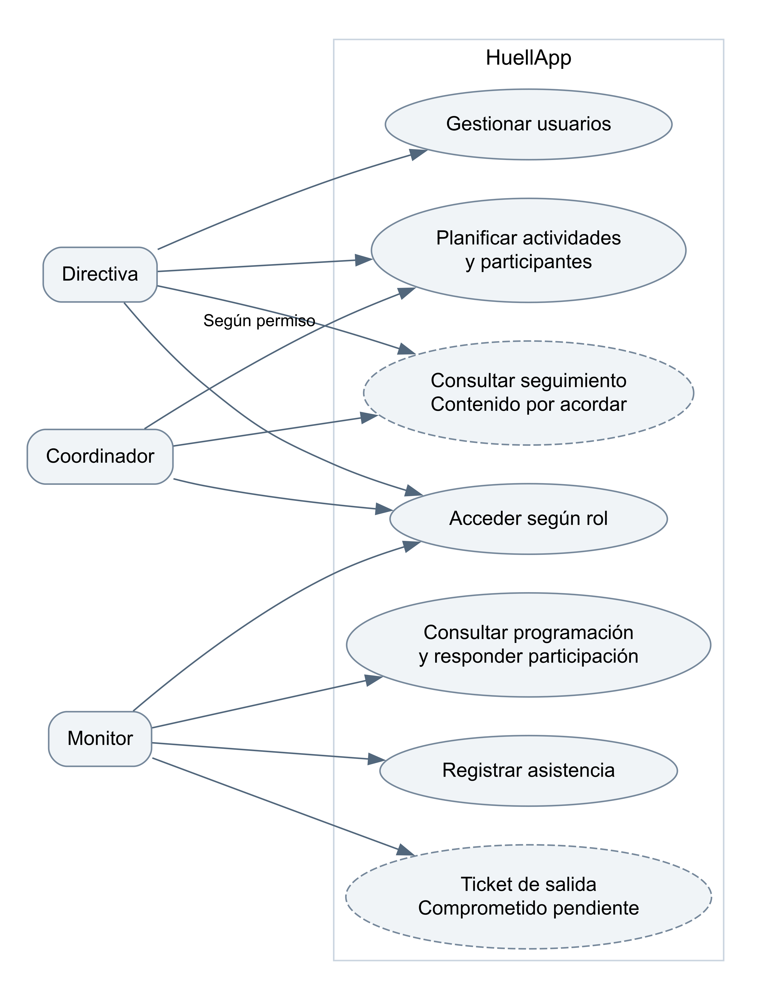
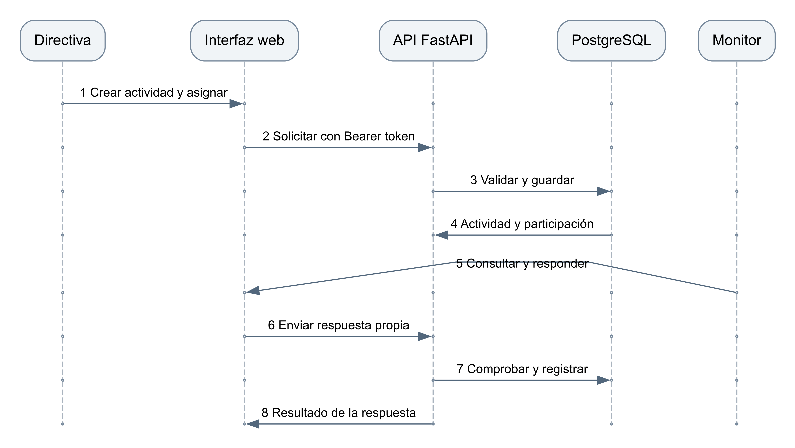

# Diagramas de análisis y diseño de HuellApp

HuellApp · Pudú Tech · Borrador 0.1 · 27 de octubre de 2026

Los diagramas sintetizan actores, componentes y recorridos del sistema para discutir su funcionamiento. Son modelos de trabajo: no certifican que cada transición ya esté implementada o validada.

## Casos de uso principales

Directiva y Coordinador disponen de funciones según permisos. Monitor consulta y responde sus participaciones y registra su asistencia. El ticket de salida se muestra como capacidad comprometida pendiente de definición y prueba. El acceso a reportes y auditoría requiere autorización expresa.

## Secuencia de una participación

La secuencia describe la creación de una actividad, la asignación, la consulta y la respuesta. El aviso de correo es un mecanismo complementario que debe probarse por separado. La aceptación del Monitor confirma su participación, no el cierre de la actividad.

## Estados y responsabilidades

La actividad y la participación tienen ciclos diferentes. La participación puede requerir respuesta y registrar aceptación o rechazo; una edición relevante puede requerir reconfirmación. La asistencia y el ticket son registros distintos. El catálogo completo de estados y las reglas finales de cierre se validarán con el código SQL y con Huella antes de aprobar el modelo.

## Modelo de dominio y componentes

El documento Modelo de datos representa Usuario, Colegio, Curso, Asignación, Participante y Asistencia. Arquitectura representa la separación entre navegador, API e infraestructura. Se entregan las fuentes DOT de los diagramas para editarlos sin reconstruir imágenes.

## Correspondencia con requisitos

HU-RF-01 y 02 cubren acceso e invitación; HU-RF-06 a 09, asignación y respuesta; HU-RF-11, asistencia; HU-RF-12, ticket. Las relaciones son trazabilidad propuesta y deben revisarse al cerrar los criterios detallados.

## Fuentes y documentos relacionados

F2: acuerdos de trabajo ratificados por Matías y acta propia actualizada; F3: código develop d2b651f42703 del 20/10/2026. Identificación y límites en Fuentes y revisión del índice del paquete.

## Validación pendiente

Validar el catálogo completo de estados y la secuencia del ticket antes de declararlos diseño final.
