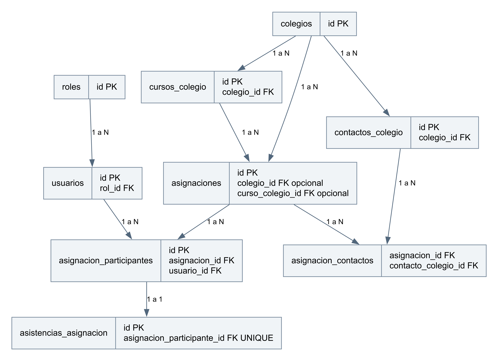

# Modelo de datos de HuellApp

HuellApp · Pudú Tech · Borrador 0.1 · 27 de octubre de 2026

Este modelo documenta entidades identificadas en las migraciones del repositorio. Describe el diseño versionado y no el estado consultado de una base desplegada. Para aprobarlo debe verificarse el historial de migraciones aplicado en el ambiente de entrega.

## Relaciones principales

El diagrama presenta las relaciones centrales y omite columnas, catálogos y relaciones auxiliares. El DDL de las migraciones constituye la referencia técnica para nombres, tipos, claves y restricciones.

## Diccionario de entidades centrales

| Entidad | Función | Relación o límite |
| --- | --- | --- |
| usuarios, roles, permisos y rol_permiso | Perfil de aplicación y permisos. | Perfil vinculado a identidad de Auth; no son contraseñas almacenadas por la aplicación. |
| colegios y usuario_colegio | Información institucional y vínculos de usuarios. | El alcance de consulta depende del permiso y vínculo aplicables. |
| cursos_colegio y salas | Organización de cursos y espacios físicos. | Asociación a colegio; comprobar reglas de eliminación lógica. |
| contactos_colegio y asignacion_contactos | Contactos y su relación con actividades. | Separan persona de contacto y su participación contextual. |
| asignaciones y tipos_actividad | Planificación y tipo de actividad. | Fechas y contexto condicionan validaciones y participación. |
| asignacion_participantes | Participación y respuesta de cada usuario. | No equivale a asistencia; enlaza usuario y actividad. |
| asistencias_asignacion | Estado informado de asistencia y ubicación. | Reglas de autoría, plazo y regularización. |
| historial_asignacion y audit_logs | Historial funcional y eventos de auditoría. | Revisar qué acciones se registran efectivamente. |
| notificaciones, notificacion_envios y notificacion_intentos | Avisos, cola e intentos de entrega. | El envío y la recepción no son equivalentes. |

## Evolución de esquema

La migración 001 define la base; la 010 rediseña asignaciones y participación. Las posteriores incorporan atomicidad, eliminación lógica, catálogo académico, notificaciones y perfil personal hasta la 055. Leer solo la 001 produciría un modelo incompleto. Se debe revisar el orden y las dependencias antes de preparar un ambiente nuevo.

## Integridad y seguridad

Verificar unicidad de identidades vigentes, claves foráneas, permisos de ejecución y políticas de acceso. Las operaciones que usan credenciales privilegiadas del backend requieren sus propios controles de autorización. La eliminación lógica no sustituye una política de conservación y eliminación de datos personales.

## Elementos aún no definidos

No se declara una tabla final de ticket de salida ni de evaluación de desempeño sin su diseño aprobado. El ticket debe definir relación con actividad y autor, campos obligatorios, modificaciones y evidencia adjunta antes de incorporar nuevas migraciones. Retención y acceso a ubicación y fotografías deben acordarse con Huella.

## Fuentes y documentos relacionados

F2: acuerdos de trabajo ratificados por Matías y acta propia actualizada; F3: código develop d2b651f42703 del 20/10/2026. Identificación y límites en Fuentes y revisión del índice del paquete.

## Validación pendiente

Contrastar DDL con el ambiente real y diseñar el ticket sin asumir tablas inexistentes.
